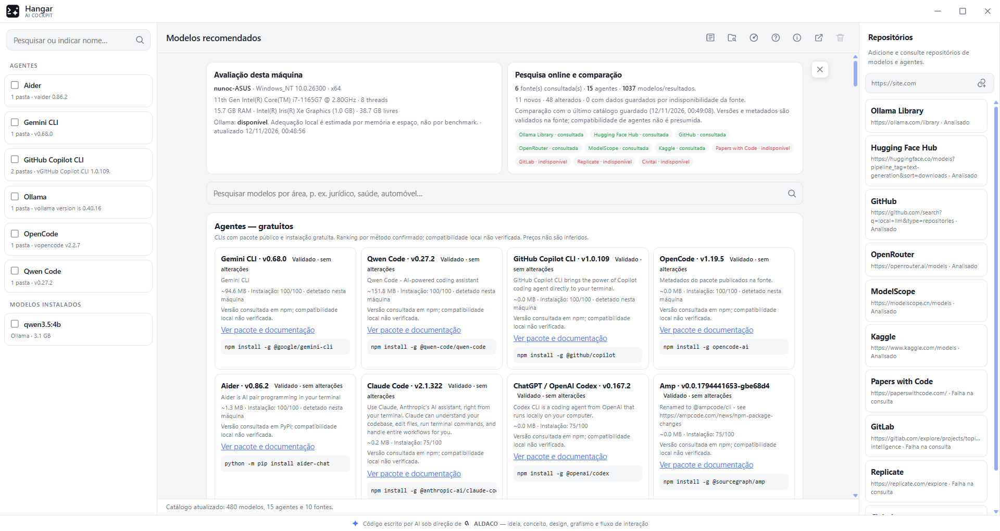
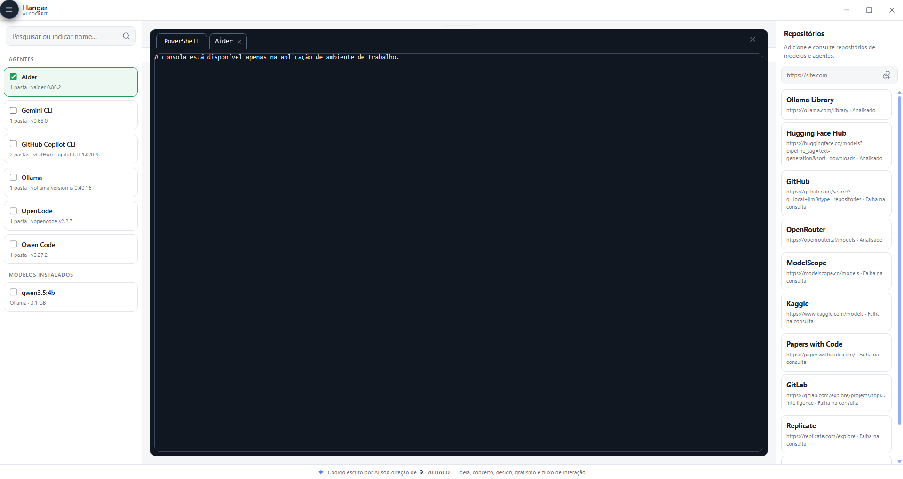
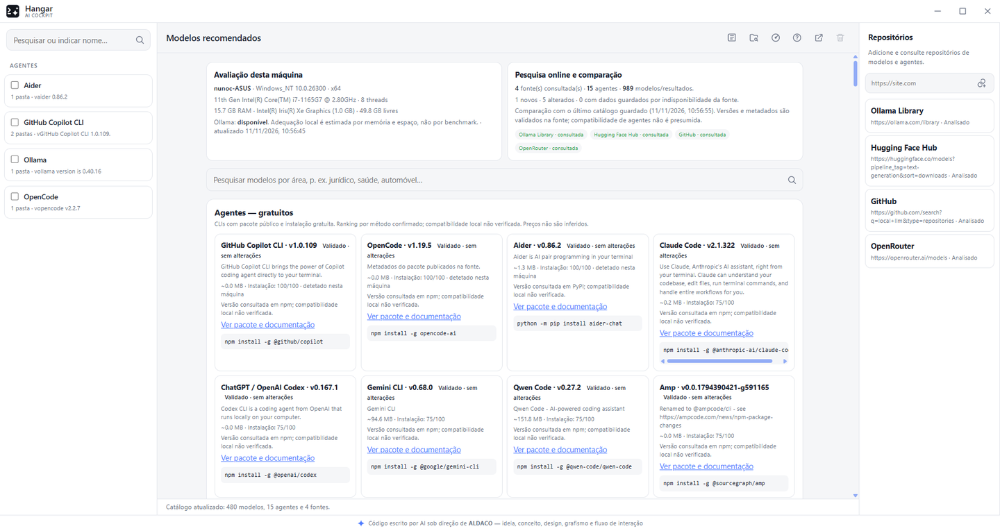
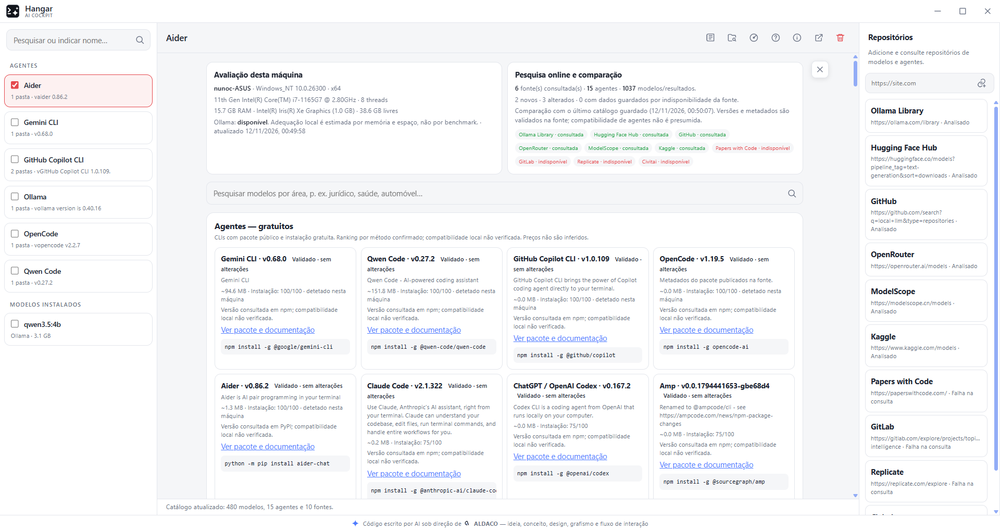
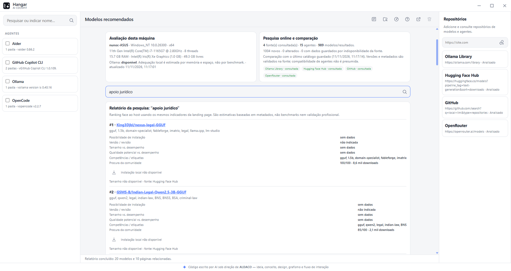

# Hangar AI Cockpit

Gestor local de agentes e modelos de IA, com uma consola real por agente e várias
sessões em paralelo no mesmo ecrã. Aplicação de ambiente de trabalho para Windows,
construída em Electron, que corre inteiramente na máquina do utilizador.

Conceito, design e interação: **ALDACO — Alexandre da Costa**.
Código sob licença **MIT**. Sem custo, sem conta, sem telemetria.



## Porque existe

Nasceu de uma necessidade concreta: desinstalar as CLI de IA que já existiam na
máquina de forma fácil e prática. Cresceu para uma gestão mais alargada — gerar
novas instalações com a mesma simplicidade — e depois para automatismos, como a
pesquisa na web a partir dos repositórios inscritos e a pesquisa de modelos por
tema escrito pelo utilizador.

## Funcionalidades

### Arranque sem AI selecionada
A aplicação abre sem modelo nem agente predefinido. Valida o equipamento, o
sistema e o catálogo, e entrega o controlo antes de qualquer conversa começar.

### Uma consola por AI, em paralelo
Cada AI assinalada abre o seu separador e a sua própria sessão. Alternar de
separador muda a conversa e mantém o contexto das restantes.



### Painel em cartões e cor de estado
Agentes e modelos aparecem em cartões, com o mesmo desenho dos repositórios:
nome, número de pastas e versão. As caixas de seleção usam a cor da interface e
mudam de cor conforme a ação pendente.



| Estado | Cor | Significado |
| --- | --- | --- |
| Repouso | azul da interface | seleção neutra |
| Ícone de eliminação ativo | vermelho | a seleção vai remover |
| Ícone de conversa ativo | verde | a seleção vai abrir sessões |



### Menu flutuante da consola
Um ícone desmultiplica-se em quatro ações — diretório de contexto, imagem,
ficheiros e limpar diretório — e desloca-se ao longo da margem da consola. O
deslocamento está limitado a uma largura de ícone para lá da margem, para que o
ícone inteiro permaneça acessível sem tapar o conteúdo.


Em agentes, os anexos são colados na consola como caminhos. Em modelos, abre o
diálogo nativo do sistema para escolher os ficheiros.

### Pesquisa de modelos por tema
Um termo escrito pelo utilizador — por exemplo *apoio jurídico* ou *consultor
financeiro* — produz um relatório ordenado face ao equipamento, com a origem de
cada resultado.



### Vigilância de instalações e novidades dos repositórios
- A aplicação observa as pastas de instalação e o armazenamento do Ollama. Quando
  surge um agente ou modelo novo, atualiza a lista e mostra uma notificação.
- As fontes com feed RSS ou Atom são consultadas a cada dez minutos. Cada novidade
  chega como notificação dedicada, com ligação para a origem.

### Ajuda da aplicação, com capturas e licenças
Um ícone próprio no topo abre a ajuda da aplicação — distinta da ajuda do agente
ou do modelo — com sete secções ilustradas e uma subsecção de licenças, incluindo
o texto integral da licença MIT e as bibliotecas de terceiros.

## Repositórios e feeds

| Fonte | Conteúdo | Feed |
| --- | --- | --- |
| Ollama Library | modelos para execução local | Atom (versões) |
| Hugging Face Hub | modelos, datasets, Spaces | RSS (blog) |
| GitHub | código, agentes, ferramentas | Atom por repositório |
| OpenRouter | catálogo de modelos cloud | sem feed público |
| ModelScope | modelos e datasets | sem feed identificado |
| Kaggle | datasets e notebooks | sem feed identificado |
| Papers with Code | artigos com código | sem feed; API |
| GitLab | projetos open-source | Atom por projeto |
| Replicate | modelos executáveis por API | sem feed identificado |
| Civitai | modelos de imagem e LoRAs | sem feed identificado |

## Instalação

### Portátil
`Hangar_Portable.exe` — não instala nada, corre a partir de qualquer pasta.

### Instalador
`Hangar_Setup.exe` — instalação por utilizador, com atalhos no ambiente de trabalho
e no menu Iniciar.

Ambos são publicados na página de releases deste repositório.

### Microsoft Store
O Hangar é publicado na Microsoft Store como aplicação Windows (MSIX/APPX), com
o nome **Hangar AI Cockpit**. A versão da loja é atualizada pela própria Store
e corre com a mesma funcionalidade da versão de ambiente de trabalho.

O pacote é gerado e validado localmente:

```bash
npm run store        # dist/win-unpacked + dist/Hangar_<versao>_x64.appx
npm run appx         # só empacota um dist/win-unpacked já existente
npm run assets:appx  # regenera ícones e escalas MSIX
```

O pacote não é assinado: a Microsoft Store assina-o na publicação. Para instalar
localmente é preciso Modo de Programador ou um certificado de teste — instruções
em [`docs/microsoft-store.md`](docs/microsoft-store.md) e textos da ficha em
[`docs/loja-ficha.md`](docs/loja-ficha.md).

### A partir do código
```bash
npm install
npm start
```

No Windows também pode usar `start.bat`, que instala dependências se faltarem e
guarda o registo em `data/logs/start-output.log`.

Para gerar os binários:
```bash
npm run dist
```

## Dados

Tudo fica na pasta `data/` do projeto ou do utilizador: definições, catálogo
cifrado e registos. Na versão MSIX a pasta de instalação é só de leitura e os
dados ficam em `%APPDATA%\Hangar\data`. Não há envio de telemetria.

A política de privacidade completa está em [`PRIVACY.md`](PRIVACY.md) e é a URL
indicada na ficha da loja.

## Licenciamento

- **Código**: MIT. Uso, cópia, modificação, fusão, publicação, distribuição,
  sublicenciamento e venda, mantendo o aviso de copyright e a licença.
- **Conceito, design e fluxo de funcionamento**: propriedade intelectual da
  ALDACO, Alexandre da Costa. A atribuição deve acompanhar qualquer reutilização,
  trabalho derivado ou apresentação pública. Ver `NOTICE.md`.
- **Bibliotecas de terceiros**: Electron 45.3.0, electron-builder 25.1.8,
  node-pty 1.1.0, @xterm/xterm 6.0.0 e @xterm/addon-fit 0.11.0, todas em MIT.

Texto integral em `LICENSE` e na secção de licenças da ajuda da aplicação.
